

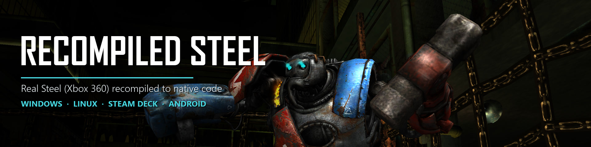

# ReCompiled Steel

### Real Steel (Xbox 360, 2011) running natively on Windows, Linux / Steam Deck and Android through static recompilation, with a native Vulkan renderer, online multiplayer and robot mods.

The original Xbox 360 game code, statically recompiled to native code with the <a href="https://github.com/rexglue/rexglue-sdk">ReXGlue SDK</a>. <b>No game files included</b>: bring your own copy of Real Steel from your Xbox 360.

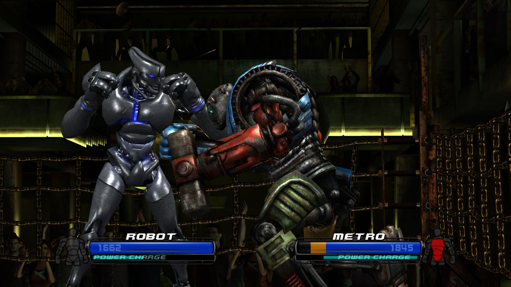

## What you need

- **Windows** 10 or 11 (64-bit) with a Vulkan 1.3 graphics card, **or** 64-bit
  Linux / a Steam Deck, **or** an arm64 Android device with Vulkan 1.3, or 1.1 /
  1.2 with the extensions the game needs (tested on a Retroid Pocket Nova)
- **Your own copy of Real Steel** from an Xbox 360: the Xbox Live Arcade game
  and its title update, plus the add-on packs if you have them

| | |
| --- | --- |
| Game | Real Steel, Xbox Live Arcade (Yuke's, 2011) |
| Title ID | `584111E0` |
| Game package | `000D0000` (Xbox Live Arcade) |
| Title update | `000B0000`, **required** (the port is built from the updated game) |
| Add-ons | `00000002`, optional (all 18 packs are supported) |
| `default.xex` | 4,825,088 bytes, CRC32 `E9E26E6B`, SHA-256 `D33B4336F93896A08FA8E4DA6257BEC2B81822332FE17D1227C11A87D038ABFB` |
| `default.xexp` (title update) | 1,390,592 bytes, CRC32 `B62B468E`, SHA-256 `8780F37E994525009F44FB929CE1A8C34DA9C9B27D72E74D4DC11FAA662A3557` |

On the console the files are under `Content\0000000000000000\584111E0\`. Copy
them off with FTP from a console running Aurora or FSD, or with a PC tool that
reads Xbox 360 storage (Party Buffalo or Xplorer360 for a hard drive,
USBXTAFGUI for a USB stick).

## Installing

1. Download **ReCompiledSteel-windows-x64-….zip** from the
   [latest release](https://github.com/tokeneffortports/ReCompiledSteel/releases/latest)
   and extract it anywhere you can write to.
2. Run **RealSteelSetup.exe**, point it at the folder with your Xbox 360 files
   and press **Install**. It finds the game, title update and add-ons by
   itself, puts the game in `game/` and `tu/` next to the program and the
   add-ons where the game keeps its saves.
3. Start **realsteel.exe**.

Saves are in `Documents\realsteel`. Every launch backs them up to `backups\`
next to them (the newest five are kept).

### Linux and Steam Deck

Download **ReCompiledSteel-linux-x64-….tar.gz** and extract it. On a Steam
Deck, do this in **Desktop Mode**. Run **realsteel-setup** (it uses the
desktop's file dialogs), then start **start.sh**. On the Deck, add `start.sh`
with **Games > Add a Non-Steam Game to My Library** and play it from **Game
Mode**. It holds 60 fps. Saves are in `~/.local/share/realsteel`.

### Android

1. Copy your Xbox 360 files (the game, its title update and any add-ons, for
   example the whole `Content` folder from your console or USB stick) to the
   device's storage or SD card.
2. Install **ReCompiledSteel-android-arm64-….apk** and open it.
3. Press **Allow file access**, then **Install game files**, and pick the
   folder you copied. The installer finds the game, title update and add-ons
   by itself and puts them in a `RealSteel` folder.
4. Press **Start**.

A built-in controller works as-is, and touch controls appear when no
controller is connected. The picture follows the way you hold the device, the
right way up either way round. More in [android/README.md](android/README.md).

**Graphics driver** (Qualcomm/Adreno devices): the game uses the device's own
driver. The launcher can load a custom Vulkan driver file you choose instead,
through [libadrenotools](https://github.com/bylaws/libadrenotools). It is off
unless you pick a file, entirely at your own risk, and not supported by this
project: check any problem with the system driver before reporting it.

### Windows SmartScreen

The release is not digitally signed, so Windows may warn the first time. If
you downloaded it from this repository's releases page, choose **More info**,
then **Run anyway**.

## Features

### Any resolution, any screen shape

The Xbox GPU is not emulated. The game still builds its Xbox 360 command
stream, and a renderer written for this game draws it directly with Vulkan,
using the game's own shaders translated ahead of time.

- Internal resolution from 720p up to 5K (2880p), MSAA, FXAA or both,
  anisotropic filtering up to 16x, v-sync on or off, HDR output on HDR
  displays
- **16:9, 16:10, 21:9 and 4:3**: the 3D view widens instead of stretching,
  and menus are laid out for the shape. The help bar sits at the bottom of
  the screen, and flashes and screen effects cover the whole picture.
- 60 fps on a Steam Deck and on a Retroid Pocket Nova at its native 1280x960
- Older Android drivers that report Vulkan 1.1 or 1.2 can work too, through
  the extensions they offer; if something is missing the game says what

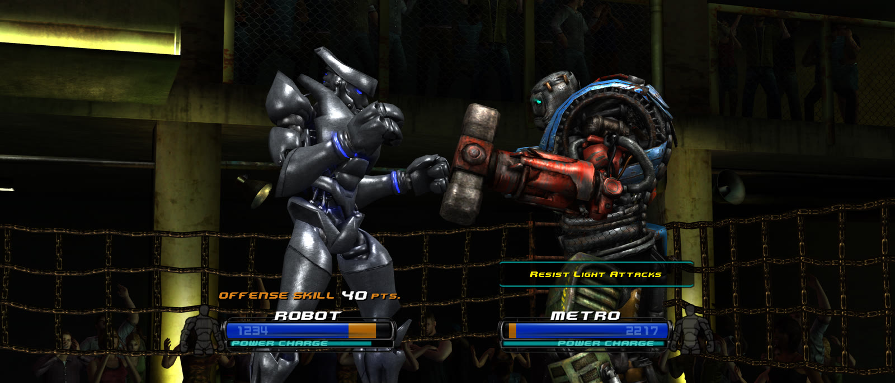
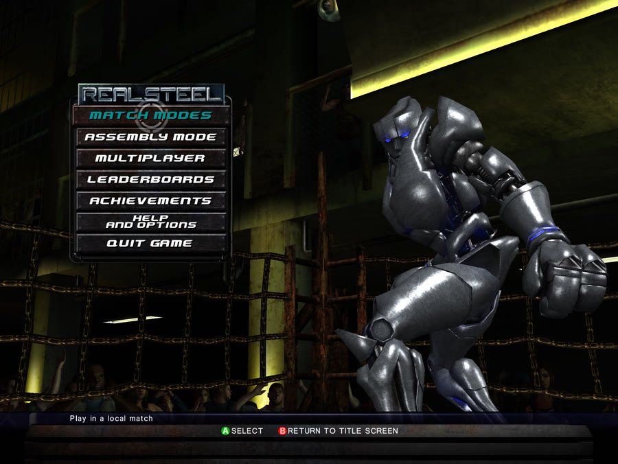 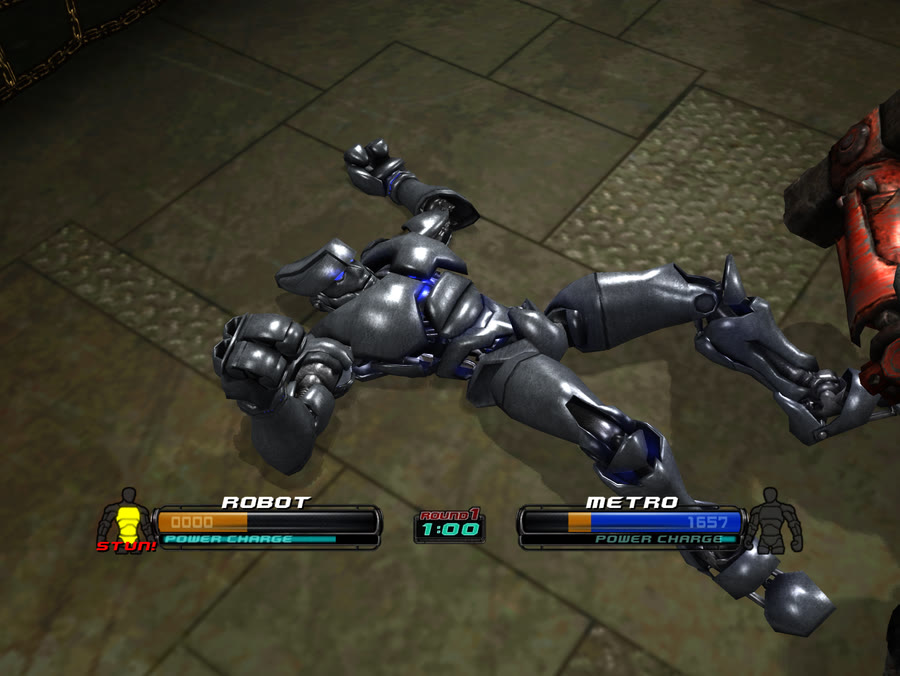 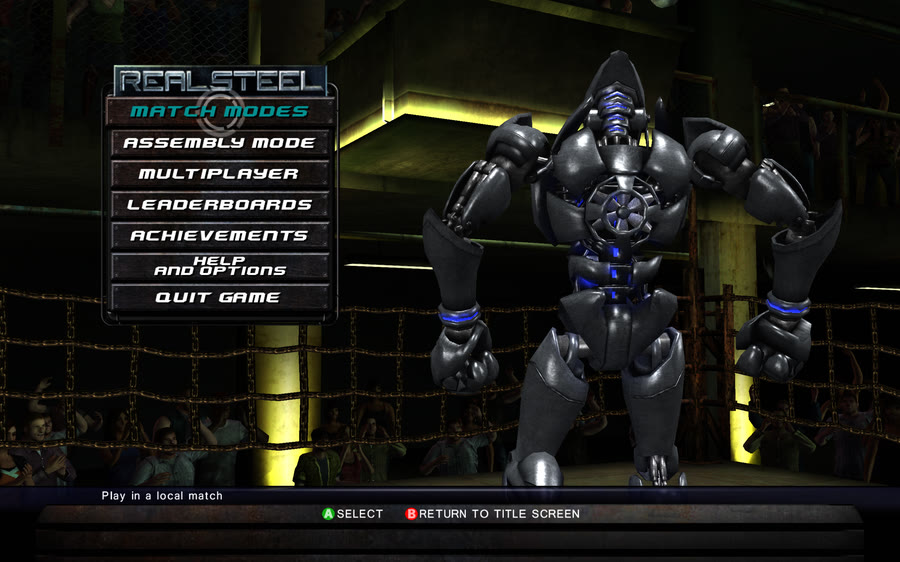
21:9 ultrawide · 4:3 (the Retroid Pocket Nova's screen) · 16:10 (Steam Deck)

### Options for slower devices

Phones and older PCs that can't hold 60 fps get a set of options under
**Graphics**. Every one is **off by default**, so the game looks and plays
exactly as made unless you turn them on:

- **Internal resolution** down to 540p, 480p or 360p
- **Crowd** off: no audience in the stands (the biggest single saving in the
  arena)
- **Texture quality: Half**: large textures at half size, for less memory and
  faster loading
- **Keep game speed**: when the device can't draw 60 frames a second, the
  game keeps its normal speed and shows fewer frames, instead of running in
  slow motion
- **FXAA** in place of MSAA, and depth of field off

**Show frame rate** and **Show memory use** (game, free memory and GPU memory)
sit in any corner you choose, to see what each option buys you.

### Settings in the game's own menus

**HELP AND OPTIONS > GAME OPTIONS** has the game's own page first, then ours,
with tabs above the panel: Display, Graphics, Audio, Controls, Game and
Cheats. Change pages with LB / RB, or click or tap a tab. **F1** (or clicking
both sticks) opens the same settings as an overlay anywhere in the game.
**F11** toggles fullscreen and **F12** saves a screenshot.

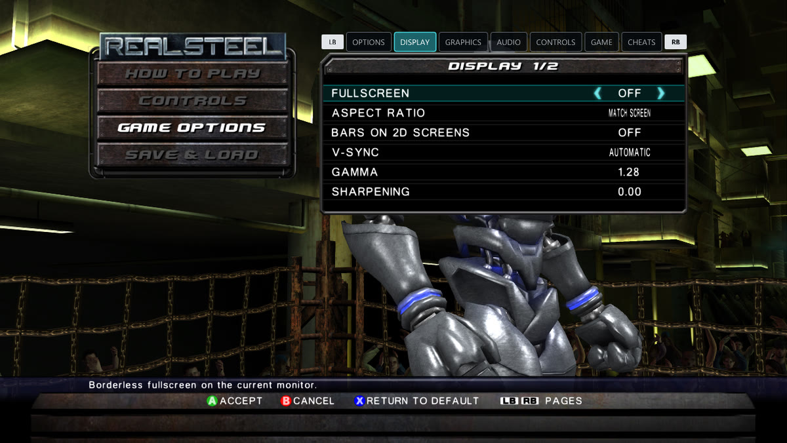

### Online multiplayer is back

Real Steel's online play ran on Xbox Live. Its own networking code is still in
the game, so this port gives it a network: **RANKED MATCH**, **PLAYER MATCH**,
**BATTLE RECORDS** and **LEADERBOARDS** work as they did in 2011. Matches are
found through a lobby server that anyone can host
([docs/lobby-server.md](docs/lobby-server.md)), on the local network, or by
typing an address. A match password keeps strangers out. Both players need
the same add-ons and mods; the panel next to the menu says what is missing.

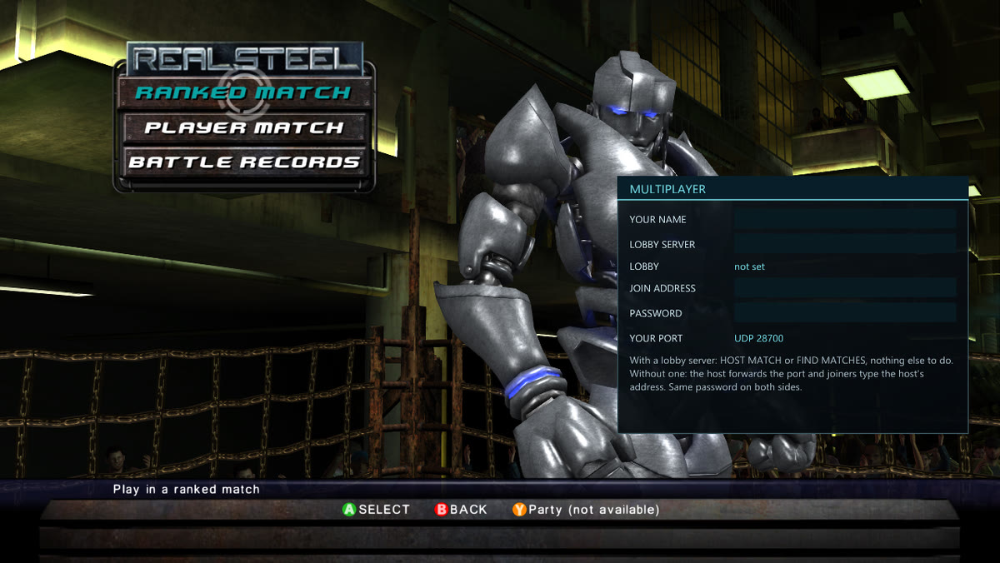

### Robot mods

Drop a robot folder into `mods/` and its parts are in the garage. A mod can
have its own models, textures, name, stats and price, built on any of the 24
stock skeletons. The game builds each robot itself when it starts, from your
own copy of the game, so a mod is just its models and pictures: no game data,
nothing to run. If a robot can't be loaded (missing add-ons, a model with a
problem) the game says which and why. When no saved robot uses a removed mod
any more, the game cleans it up. Making one: [docs/modding.md](docs/modding.md).

Two new robots made for this project come with every release as a separate,
optional download (**ReCompiledSteel-mods-….zip**, public domain): **ANGLER**,
a deep-sea salvage diving suit with an anglerfish lure, and **QUILLBACK**, a
spiked speedster with seven glowing gems caged in its waist. Both light up in
the glow colour you pick.

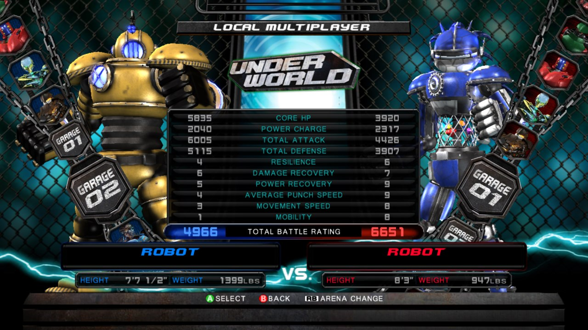

### And the rest

- **Achievements** with unlock pop-ups, and the full list in the game's menus
- **Keyboard controls** you can rebind, next to any controller the system
  knows
- **Touch controls** on Android that you can arrange: drag any button where
  you want it, and change its size, shape (circle, rounded, square or a
  curved kidney) and angle, plus overall size and see-through
- **Local multiplayer** on one PC with two controllers
- All 18 **add-on packs** (robots and stages), when you have them
- A **Cheats** tab (game speed, cash), English or Japanese, mute in the
  background, and **QUIT GAME** on the main menu (DOWNLOAD CONTENT is gone)

| Xbox button | Key | | Xbox button | Key |
| --- | --- | --- | --- | --- |
| Left stick | W A S D | | Right stick | arrow keys |
| A / B | Space / Backspace | | X / Y | J / K |
| LB / RB | U / I | | LT / RT | Shift / Ctrl |
| Start / Back | Enter / Tab | | D-pad (taunts) | 1 2 3 4 |

## Screenshots

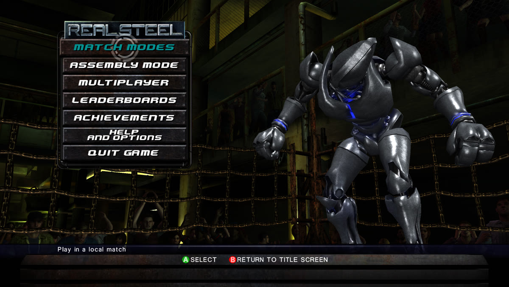 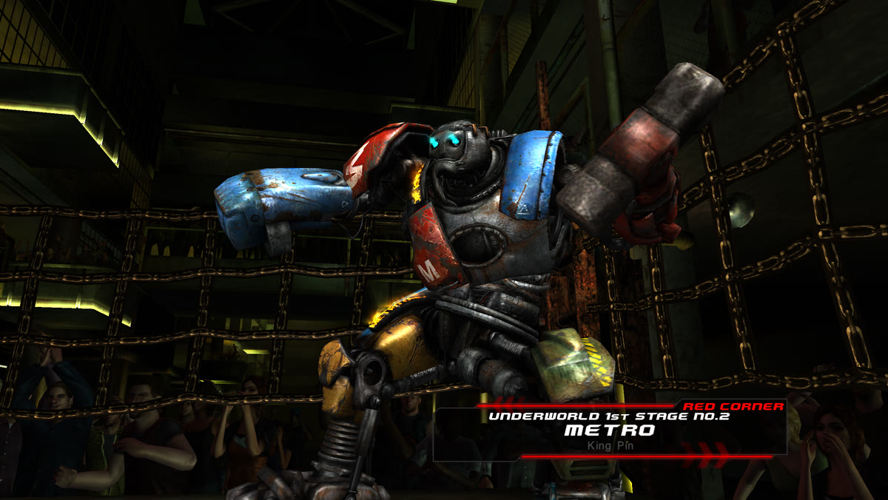
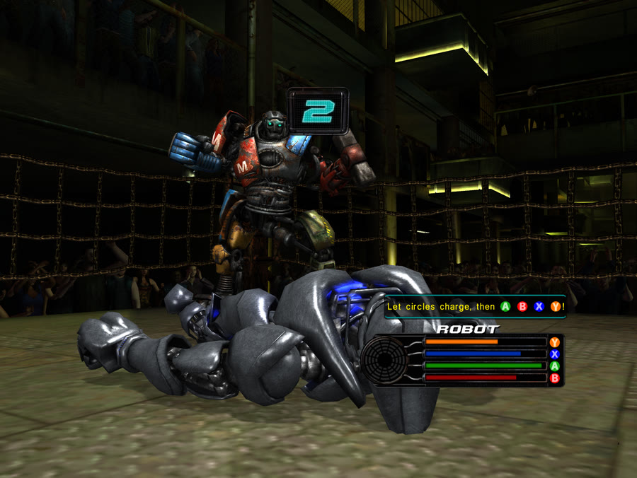 

## Why a recompilation, and not Xenia?

Xenia is a great emulator, and it plays hundreds of games. This plays one,
and that is the point: the game's own code was translated once, ahead of time,
and compiled into a native program. Nothing is translated while you play,
nothing pretends to be the Xbox GPU, and there's no emulator around the game.
That's what makes the rest possible: any resolution and screen shape, 60 fps
on handhelds, online play on a network that outlived Xbox Live, mods loaded
from a folder, and settings in the game's own menus. If you want your whole
Xbox 360 library, use Xenia. If you want Real Steel to feel like it was made
for your PC, Steam Deck or handheld, this is for you.

## Known issues

- The **MY SCORE** page of the leaderboards stays empty; the rankings pages
  work.
- Online play across the internet relies on the lobby server's hole punching,
  which has been tested on few networks. A host may have to forward the UDP
  port the panel shows.
- At 4:3 and 16:10, the full-screen fades in fights only cover the 16:9 part of
  the picture.
- On Android, the Retroid Pocket Nova is the main test device; a few phones
  have been tried too.

## Reporting problems

Open an [issue](https://github.com/tokeneffortports/ReCompiledSteel/issues)
with the newest `rex_latest.log` from next to the program, and say what you
were doing when it happened. On Android, press **Save diagnostics** in the
launcher and attach the zip it writes to `RealSteel/logs/`.

## Building it yourself

The recompiled C++ and the shader cache are generated from your own game
files, so the repository contains neither. In short: the ReXGlue SDK 0.10,
clang, CMake, Ninja and Python, your game files in `work/`, then
`cmake --preset win-amd64-release` and `cmake --build --preset
win-amd64-release` (`tools/build_linux.sh` on Linux, `android/` for Android).
Step by step: [docs/building.md](docs/building.md).

## Credits

- **Real Steel** (2011) by **Yuke's Co., Ltd.** for Xbox Live Arcade. Real
  Steel is a trademark and copyright of DreamWorks II Distribution Co., LLC.
  This is an unofficial fan project, not affiliated with or endorsed by
  Yuke's, DreamWorks or Microsoft, and it contains none of their files.
- **[ReXGlue SDK](https://github.com/rexglue/rexglue-sdk)** by tomcl7 and
  contributors: the static recompiler and the runtime the game runs on, which
  build on **[Xenia](https://github.com/xenia-project/xenia)**,
  **[XenonRecomp](https://github.com/hedge-dev/XenonRecomp)** and rexdex's
  recompiler work.
- **[XenosRecomp](https://github.com/hedge-dev/XenosRecomp)** by hedge-dev, the
  Xbox 360 shader translator (used with `thirdparty/XenosRecomp-realsteel.patch`),
  and **[Unleashed Recompiled](https://github.com/hedge-dev/UnleashedRecomp)**,
  which showed how a recompiled port should work.
- **[Skate 3 Android port](https://github.com/luisxl15/SKATE-3-ANDROID-PORT)** by
  luisxl15, whose notes on Android guided ours.
- Libraries, all downloaded by the build or part of the SDK (none are kept in
  this repository): [volk](https://github.com/zeux/volk), [Vulkan-Headers](https://github.com/KhronosGroup/Vulkan-Headers),
  [zstd](https://github.com/facebook/zstd), [smol-v](https://github.com/aras-p/smol-v),
  [libadrenotools](https://github.com/bylaws/libadrenotools) (Android),
  and through the SDK [Dear ImGui](https://github.com/ocornut/imgui), [SDL3](https://github.com/libsdl-org/SDL),
  FFmpeg and more. Every one, with its
  licence, is in [packaging/licenses](packaging/licenses/THIRD-PARTY-LICENSES.txt).
- The Xbox 360 formats were understood thanks to Xenia, Free60 and the
  homebrew community. Real Steel's own formats (PAC archives, BPE compression,
  JBOY models) were worked out for this project.
- The engineering was done with **Claude** (Anthropic), through Claude Code.

[thefixinhixon's RealSteelRecomp](https://github.com/thefixinhixon/RealSteelRecomp)
is a separate ReXGlue recompilation of the same game; the two share no code.

## License

GPL-3.0 ([LICENSE](LICENSE)). The third-party pieces keep their own licences.
Nothing here grants any right to the game itself.
